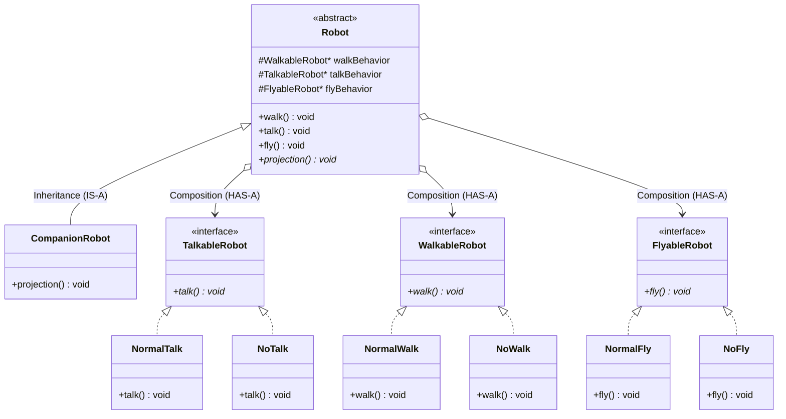

# Robot Types - Strategy Design Pattern (Low-Level Design)

A clean Low-Level Design (LLD) demonstration of the **Strategy Design Pattern** in C++, emphasizing **Composition over Inheritance**.

## 📌 Core Problem & Motivation
In standard Object-Oriented Design, attempting to represent complex combinations of behaviors through class inheritance leads to **class explosion** (e.g. `WalkTalkNoFlyRobot`, `NoWalkTalkFlyRobot`, etc.).

By using the **Strategy Pattern**:
- Behaviors (`WalkableRobot`, `TalkableRobot`, `FlyableRobot`) are encapsulated into distinct strategy interfaces.
- The base `Robot` class composes these behaviors (**HAS-A relationship**) rather than inheriting them.
- New behaviors and robot types can be added without modifying existing code (Open/Closed Principle).

---

## 🏗️ Architecture



---

## 🚀 How to Build and Run

### Prerequisites
- GCC / G++ (C++11 or higher)

### Compile & Execute
```bash
g++ -std=c++17 StrategyDesignPattern.cpp -o StrategyDesignPattern.exe
./StrategyDesignPattern.exe
```

### Expected Output
```text
Projecting hologram companion...
Walking normally...
Talking normally...
Cannot fly.
```
